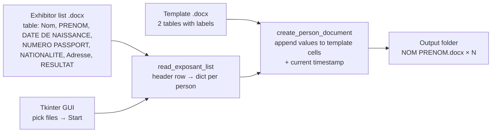

# DOCX Certificate Generator

[](https://github.com/MehdiBedja/docx-certificate-generator/actions/workflows/tests.yml)


A small desktop tool that **generates one filled-in Word document per person** from a list. You give it a `.docx` file containing a table of people and a `.docx` template, and it produces a personalized certificate for each row (name, date of birth, passport number, nationality, address, PCR result and timestamp) in seconds. That replaces hours of copy-pasting.

It was built to automate PCR certificate paperwork for event exhibitors, and ships as a single Windows `.exe` so non-technical staff can use it.


<!-- Screenshot placeholder: add docs/screenshots/app.png -->

## How it works



1. **Read the list.** The first table of the list document is parsed, and its header row becomes the keys for every person.
2. **Fill the template.** For each person, the template is loaded fresh and values are appended after the existing labels in table 1 (identity) and table 2 (test type, result, date and time).
3. **Save.** Each document is written as `<Nom> <PRENOM>.docx` in the chosen folder, which then opens automatically.

Optional columns (passport, nationality, address) are skipped when absent.

## Run it

**Windows, no install:** download [`dist/FillApp.exe`](dist/FillApp.exe) and double-click it.

**From source:**

```bash
git clone https://github.com/MehdiBedja/docx-certificate-generator.git
cd docx-certificate-generator
pip install -r requirements.txt
python FillApp.py
```

Then pick the exhibitor list, the template and an output folder, and click **Start Processing**.

**Build the exe:**

```bash
pip install pyinstaller
pyinstaller --onefile --windowed FillApp.py
```

## Tests

```bash
pip install -r requirements.txt -r requirements-dev.txt
pytest
```

The tests generate list and template documents on the fly and cover table parsing, whitespace handling, template filling, missing optional fields, one output file per person, and that the template is never modified.

## Files

| File | Purpose |
| --- | --- |
| `FillApp.py` | The application: GUI and document processing |
| `tests/` | pytest suite |
| `dist/FillApp.exe` | Packaged Windows build |
| `merging.py`, `retreiveInfo.py`, `putInfoInPcrFile.py`, `try.py` | Earlier prototypes of the reading and filling steps |

## Author

**Mahdi Bedja** · [Portfolio](https://mehdibedja.github.io) · [LinkedIn](https://www.linkedin.com/in/mahdi-bedja-0b94031b3/)
